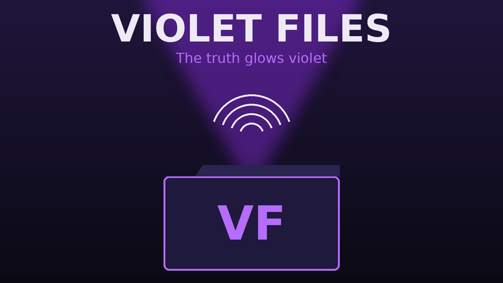

# الملفات البنفسجية — Violet Files

> «الحقيقة تتوهج بنفسجي.» / *The truth glows violet.*

لعبة محقق خاص للجوال بمحرك **Godot 4.3**، مبنية على وثيقة تصميم اللعبة (93 صفحة).
هذه **النسخة الأولى القابلة للعب (Vertical Slice)** كما توصي الوثيقة نفسها: تفاوض، تحقيق، أدلة، تسليم الملف، واقتصاد.

A mobile private-detective game made with **Godot 4.3**, built from the 93-page design document.
This is the first playable vertical slice.

## جرّبها / Try it
- **على الويب (بدون تثبيت):** فعّل *Settings → Pages → Source: GitHub Actions* ثم ادفع إلى `main`؛ الـ workflow يبني نسخة ويب قابلة للعب.
- **في المحرك:** افتح المجلد بـ Godot 4.3 واضغط ▶ (المشهد الرئيسي `scenes/main_menu.tscn`).
- **اختبارات المنطق:** `godot --headless --path . -s tests/run_tests.gd`
- **فحص البيانات بدون محرك:** `python3 tools/validate_data.py`

## ما الموجود؟
| النظام | الحالة |
|---|---|
| القائمة الرئيسية، الإعدادات (عربي RTL / English)، الحفظ | ✅ |
| الشقة والمكتب، الهاتف، النوم، الإيجار، الإفلاس | ✅ |
| التفاوض (صبر/جشع/ميزانية/صدق + الطرد + تمثيل الغضب) | ✅ |
| التوتر المخفي وقراءة الكذب (خط الأساس، الوجه المتحرك، الثقة، التعب) | ✅ |
| مسرح القضية: مسح بإصبعك، الضوء البنفسجي، البصمات، العدسة، تصوير بجودة | ✅ |
| الاختباء، الحقيبة المحدودة، لوحة التحقيق، التقييم بالنجوم | ✅ |
| المتجر والهواتف، سمعة الأحياء، لوحة ياسر السرية | ✅ |
| التقييم الرسمي (قسم 21)، لحظات القرار، ما فاتك، 3 مستويات صعوبة | ✅ |
| القضايا 1 و2 و3 من الموسم الأول | ✅ |
| القضايا 4–10، الزميل الذكي، LAN، أونلاين، عالم 3D، الصوت | ❌ لاحقًا |

التفاصيل الكاملة لكل قسم من الوثيقة: [`docs/IMPLEMENTATION_STATUS.md`](docs/IMPLEMENTATION_STATUS.md)
شرح الملفات وكيف تضيف قضية: [`docs/GUIDE_AR.md`](docs/GUIDE_AR.md)

## الرخصة / License
MIT — انظر `LICENSE`. الخط DejaVu Sans برخصته الخاصة في `assets/fonts/`.
